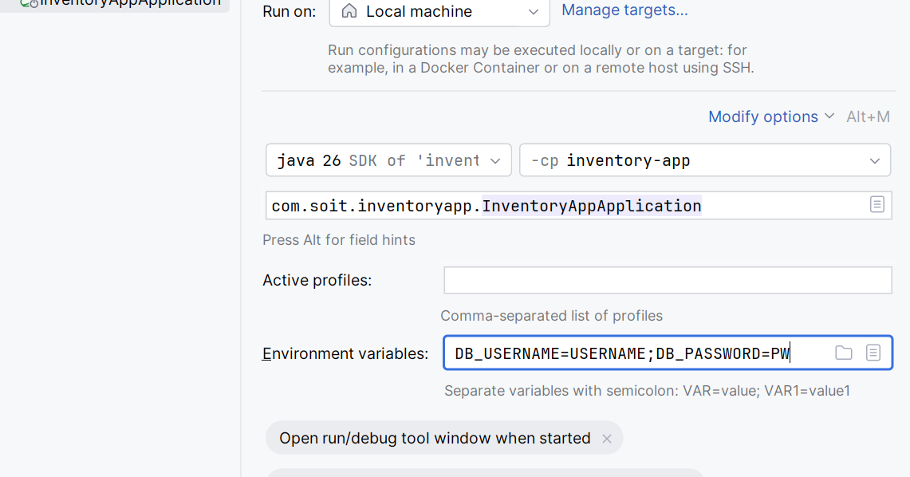

# inventory-management-system
The Inventory Management System (IMS) is a web-based application designed to help businesses organize and manage inventory records. Users will be able to add, view, update, and delete inventory items, monitor stock levels, and identify items that need restocking. The application will also include user authentication, role-based permissions, and inventory reports. It will be developed using Java, Spring Boot, Thymeleaf, Bootstrap, MySQL, and Spring Data JPA.

Team Member Role Responsibilities Kaylah Hammond Product Owner / GitHub Repository Owner Manage project requirements, coordinate tasks, track progress using a Kanban board, and maintain the GitHub repository. Olamilekan Esan Frontend Developer Develop the application's pages, forms, and navigation using Thymeleaf and Bootstrap. Xander Marsden Backend / Database Developer Develop controllers, services, CRUD operations, and database interactions using Spring Data JPA and MySQL. Caitlin Reardon Security & Integration Developer Implement user login, authentication, and role-based permissions using Spring Security.

# 1. Clone the GitHub Repository

- Clone the inventory-management-system repository from GitHub.

- Open the project in IntelliJ IDEA.

- Locate the inventory-app folder containing the pom.xml file.

- Allow Maven to load the required dependencies.

# 2. Set Up the MySQL Database

Each team member must configure their local MySQL database before running the application.

- Start WAMPServer and open phpMyAdmin.

- Create an empty database named "inventorydb".

- Do not manually create any tables.

The application is configured to automatically create and update database tables using Hibernate. This is enabled in the application.properties file
# 3. Configure Database Credentials

Each team member must configure their own MySQL credentials in IntelliJ.

- Open the project in IntelliJ IDEA.

- Navigate to Run → Edit Configurations.

- Select the InventoryAppApplication configuration.

- Find the Environment variables section.(May need to go to modify options to find setting)

- Add the following variables: Add the environment variables shown below. Replace "USERNAME" and "PW" with your own MySQL account username and password.
  
- Click "OK"

# 4. Application Login

The application currently uses a shared Spring Security login for development and testing.

Username: soitadmin

Password: it4045

These credentials are used to access the Inventory Management System and are separate from the MySQL database credentials.

The shared login is intended for local classroom testing only. 
# 5. Run the Application

- Make sure WAMPServer and MySQL are running.
- Make sure the `inventorydb` database has been created and your environment variables have been configured.
- Run the Spring Boot application.
- Refresh phpMyAdmin to verify that the database tables have been automatically created.
- Open http://localhost:8080/Inventory/list in your browser.
- Enter the shared application login credentials.

Once logged in, you should be able to access the Inventory Directory.

**Note:** Each team member has their own local database. Database structures will be generated from the project's entity classes, but individual database records are not shared between team members.