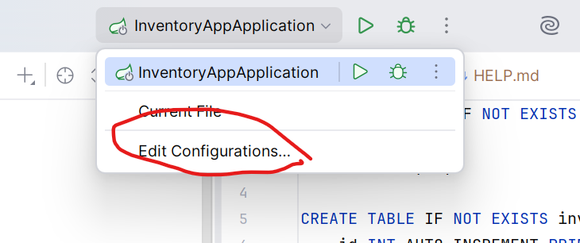

# inventory-management-system
The Inventory Management System (IMS) is a web-based application designed to help businesses organize and manage inventory records. Users will be able to add, view, update, and delete inventory items, monitor stock levels, and identify items that need restocking. The application will also include user authentication, role-based permissions, and inventory reports. It will be developed using Java, Spring Boot, Thymeleaf, Bootstrap, MySQL, and Spring Data JPA.

Team Member Role Responsibilities Kaylah Hammond Product Owner / GitHub Repository Owner Manage project requirements, coordinate tasks, track progress using a Kanban board, and maintain the GitHub repository. Olamilekan Esan Frontend Developer Develop the application's pages, forms, and navigation using Thymeleaf and Bootstrap. Xander Marsden Backend / Database Developer Develop controllers, services, CRUD operations, and database interactions using Spring Data JPA and MySQL. Caitlin Reardon Security & Integration Developer Implement user login, authentication, and role-based permissions using Spring Security.

# 1. Clone the GitHub Repository

- Clone the inventory-management-system repository from GitHub.

- Open the project in IntelliJ IDEA.

- Locate the inventory-app folder containing the pom.xml file.

- Allow Maven to load the required dependencies.

# 2. Set Up the MySQL Database

- Each team member will need to set up their own local MySQL database.

- Start WAMPServer and open phpMyAdmin.

- Locate the database-setup.sql file in the main project folder.

- Copy the SQL code from the file.

- In phpMyAdmin, navigate to the server-level SQL tab.

- Paste the SQL code and click Go.

- The script will create the following:

    - Database: inventorydb

    - Table: inventory_item

The database will initially be empty. Inventory items can be added through the application.

# 3. Configure Database Credentials

Each team member must configure their own MySQL credentials in IntelliJ.

- Navigate to Run → Edit Configurations.

- Select the InventoryAppApplication configuration.

- Find the Environment variables section.(May need to go to modify options to find setting)

- Add the following variables: REPLACE "USERNAME" & "PW"  WITH YOUR OWN USERNAME AND PASSWORD
  
- Click "OK"

# 4. Application Login

The application currently uses a shared Spring Security login for development and testing.

Username: soitadmin

Password: it4045

These credentials are used to access the Inventory Management System and are separate from the MySQL database credentials.

The shared login is intended for local classroom testing only. 
# 5. Run the Application

- Make sure WAMPServer and MySQL are running.

- Open InventoryAppApplication.java in IntelliJ.

- Run the Spring Boot application.

- Open http://localhost:8080/Inventory/list in your browser.

- Enter the shared application login credentials.

Once logged in, you should be able to access the Inventory Directory.